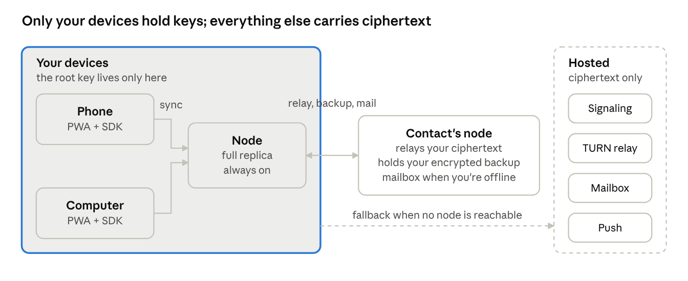
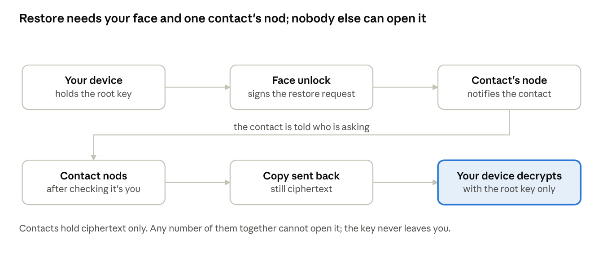
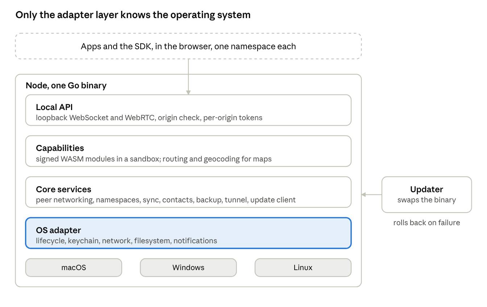
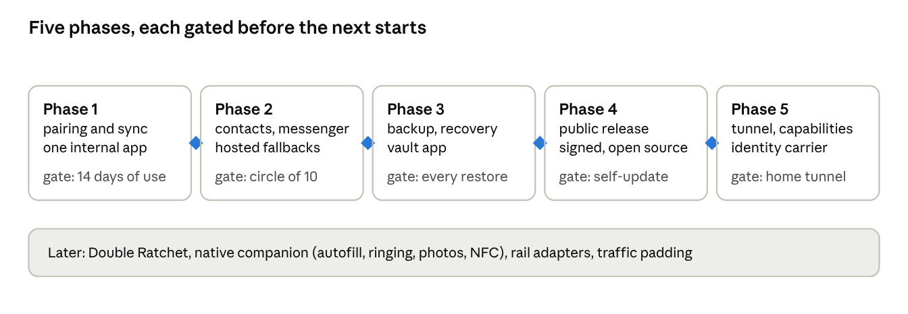

# Personal Node System Specification v1

Oct 11, 2026 · @Erick

## Overview

The system is a personal node that runs on a user's computer, plus a family of zero-dependency progressive web apps (PWAs) that store all data on the user's own devices and sync between them without any company in the middle. Nobody but the user holds a key. Nobody but the user and the contacts they choose holds a byte.

The promise to the user in one sentence: your data lives only on your devices and with the people you trust, it survives the loss of any device, and nobody can read it, find you, or lock you out. It is a complete ecosystem, with no operating system under it and no account in it, in which privacy, ownership and sovereignty are consequences of one design decision: nobody is ever asked to trust anyone they did not already trust.

**What exists**

- The node: one small binary, installed once per computer, free and open source. It is the always-on replica, the relay for the user's contacts, the holder of encrypted backups for contacts, and the private tunnel endpoint.
- The apps: free PWAs with zero dependencies, installed from the browser on phone and computer. The messenger, the vault, and the identity carrier are the three launch apps, all free. Every app works on the phone alone and gets history, backup, recovery and always-on presence when a node is present.
- The SDK: one small library every app includes. It talks to the node when present and to browser storage and the fallback relay when not, through the same API.
- Minimal hosted infrastructure: a signaling endpoint, a TURN relay of last resort, a short-lived encrypted mailbox for phone-only users, and push notification forwarding. All of it sees ciphertext or connection metadata only, and all of it is bypassed whenever a node is reachable.

**Who it is for**

People who want out of provider-held cloud storage and provider-run messaging: the privacy-minded, people leaving the large ecosystems, professionals who cannot put client data in a cloud they do not control, and self-hosters tired of maintaining things. Growth is by invitation only, through contact cards, with no advertising.

**Scope of this document**

This is the version 1 specification for the node, the SDK, identity, pairing, storage, sync, networking, contacts, backup and recovery, the private tunnel, the node's own architecture, the security model, pricing, and the build order. The maps app and other apps are consumers of this system and are specified separately, except where they force a requirement here.

## Principles and non-goals

Every design decision below follows from these rules. When a later choice conflicts with one of them, the rule wins.

**Principles**

1. The company holds nothing. No accounts, no user records, no plaintext, no keys, no logs. A subpoena to the company yields nothing because there is nothing.
2. One key per person. All data of all apps is protected by one root key, so there is one pairing flow, one recovery flow, and one thing to protect.
3. Keys never leave the person. The root key exists only on the person's devices, sealed in secure hardware behind biometrics. Contacts hold ciphertext and, for total-loss recovery only, pieces of the key that are useless alone.
4. Hardware is interchangeable. Any device with a browser is a full peer. Any device that runs the node is a home replica. Losing any device is recoverable from any other.
5. The node is app-agnostic. It knows namespaces, documents, blobs and peers. It never contains app-specific logic. App-specific heavy work ships as a sandboxed capability module, never as a change to the node.
6. Progressive, never required. Every app is fully usable on a phone with no node. The node makes it better. The SDK hides the difference.
7. Zero dependencies in apps. Apps ship as static files with no third-party code. They do not rot, they can be audited end to end, and there is no supply chain.
8. You can only be found if you want to be found. There is no directory. Contact is established only by handing someone your card.
9. Nobody carries risk for someone else. Nodes relay and store ciphertext for contacts. Nodes never exit internet traffic for anyone but their owner.
10. Free. Nothing in the system is sold to anyone. A price needs a seller, an account and a record, and reciprocity between contacts only works unpriced. The small fixed costs of certificates, audits and upkeep are carried by stewards whose mission the system serves.
11. Leaving is easy. Open formats, one-click export of every namespace, open-source node, documented protocol.
12. No marketing. Growth is by contact card. The product communicates through a plain website, documentation, a changelog, and answered questions.

**Non-goals for version 1**

- A global ledger, consensus, mining, or any token. There is no shared state to secure.
- Anonymity against a global observer. The system hides content and prevents discovery; it is not Tor.
- Exit-node service for other people. Only self-exit through one's own node.
- Whole-device VPN on phones. A PWA cannot be a VPN. The node's tunnel covers the computer and the apps themselves.
- A custom browser or rendering engine.
- Relay or storage for strangers. Only for contacts.
- Full-device backup of the computer. The node backs up namespaces, not the operating system.
- Importing chat history into third-party messengers. Export is in an open format; what others accept is outside our control.

## System components

Four pieces, three of them user-owned. The node and the apps do all the work; the hosted pieces exist only to bridge the moments when two user devices cannot reach each other.

Sync runs between your own devices. A contact's node relays, holds mail, and stores your encrypted backup. The hosted services are reached only when no node is reachable, and see ciphertext.

| Component | Runs on | Written in | Holds | Ships as |
| --- | --- | --- | --- | --- |
| Node | User's computer, mini PC, Raspberry Pi | Go, single static binary | Full replica of every namespace, root key sealed in OS keychain, contacts' encrypted backups and mail | Signed download per OS and CPU; Homebrew, winget, shell script |
| Apps | Phone and computer browsers, installed as PWAs | HTML, CSS, JS, zero dependencies | Partial or full replica in OPFS and IndexedDB; root key wrapped by a passkey | Static files on a CDN; installed from the address bar |
| SDK | Inside every app | JS, zero dependencies, one file | Nothing of its own | Vendored into each app at build time |
| Signaling | Hosted | Go | Ephemeral session offers, no persistence | One small service |
| TURN relay | Hosted | coturn or Go | Nothing; forwards ciphertext | Last resort only |
| Mailbox | Hosted | Go plus object storage | Ciphertext blobs with a 14-day time-to-live, addressed by opaque mailbox id | Only for recipients with no reachable node |
| Push forwarder | Hosted | Go | Device push tokens, encrypted to the device, no content | Wakes a phone; payload is an empty ping |

**The node** is one process with these internal services: peer networking, namespace store, document sync, blob store, contact relay, contact backup store, tunnel endpoint, capability runtime, and self-update. All are described in their own sections.

**The SDK** exposes one API to apps: identity, namespace, documents, blobs, contacts, and messaging. Internally it has two backends with identical behavior. The node backend talks to a node over WebRTC or a local WebSocket. The browser backend uses OPFS, IndexedDB, and the hosted signaling, relay and mailbox. The app never knows which backend is active, except through an optional status call used to show the user whether a node is connected.

**The apps** are independent static sites, one origin each. The node identifies an app by its origin. Apps share nothing with each other except the root identity and the SDK; one app's namespace is invisible to another.

**Hosted infrastructure** is designed to be replaceable and to disappear. Every hosted service is bypassed when a node is reachable, directly or through a contact's node. A user whose circle includes one node owner never touches the mailbox. The signaling and relay services can be run by anyone from the open-source repository; the SDK takes their addresses as configuration.

## Identity and keys

One root key per person, generated on the first device, never sent to any server, and never held by any contact. Everything else is derived from it.

**Primitives**

| Purpose | Primitive |
| --- | --- |
| Root secret | 32 random bytes from the OS random source |
| Key derivation | HKDF-SHA256 with a fixed info string per purpose |
| Signing | Ed25519 |
| Key agreement | X25519 |
| Symmetric encryption | XChaCha20-Poly1305 |
| Hashing and content addresses | BLAKE3 |
| Session channels | Noise IK handshake over the transport, then symmetric |
| Tunnels | WireGuard |
| Browser key sealing | WebAuthn passkey with the PRF extension |

All of these have mature, audited implementations in Go and in the browser's Web Crypto API or small audited JS. No custom cryptography anywhere.

**Derivation tree**

- root: the 32-byte secret.
- identity signing key: derived from root with info "identity-sign". Its public half is the person's permanent identifier.
- identity agreement key: derived with info "identity-agree". Used by contacts to encrypt to the person.
- per-app key: derived with info "app:" plus the app origin. Encrypts that namespace's documents and blobs. One app cannot derive another's key.
- backup key: derived with info "backup". Encrypts snapshots stored on contacts' nodes.
- mailbox address: derived with info "mailbox", truncated. Opaque, rotatable, carries no identity.

Derivation is deterministic, so any device that holds root can reconstruct every key with no state exchange.

**Where the root lives**

- On the node: in the OS keychain (Keychain on macOS, Credential Manager on Windows, Secret Service on Linux), wrapped by a key the OS protects. Where secure hardware is available the wrapping key is hardware-bound.
- In the browser: wrapped by a secret derived from a passkey through the WebAuthn PRF extension. The passkey lives in the device's secure enclave and opens with face or fingerprint. The wrapped root sits in IndexedDB with the storage-persist flag requested. Supported today in Chrome, Safari, iOS and Android.
- Never: on any server, on any contact's device, in any file the user is asked to keep, in any form the software itself stores biometric data. Biometrics are the OS's gate to the enclave and nothing more.

**Unlock**

Opening an app triggers a passkey assertion. The OS asks for a face or fingerprint, the enclave releases the PRF output, the SDK unwraps root into memory, derives what it needs, and zeroes root. On the node, the keychain releases the wrapped root at process start; on macOS and Windows this can require a one-time user approval.

**Rotation**

Root never rotates in normal operation. It rotates only on recovery after a suspected compromise, as described in Backup and recovery, which re-encrypts all namespaces and reissues contact cards. The mailbox address and contact cards rotate independently and cheaply.

## Devices and pairing

A device joins a person's set by receiving the root from a device that already has it, over a channel both sides authenticate in person. The person consents with their face on the existing device. No server participates.

**Device record**

Each device has its own Ed25519 device key, generated locally and never derived from root. The person's device list is a signed document in a reserved namespace, replicated like any other, with one entry per device: device public key, a human name, platform, date added, and a status of active or revoked. Entries are signed by the identity signing key.

**Pairing flow**

1. The new device generates its device key and a one-time X25519 pairing key, and shows a QR code containing both public halves and its current reachable addresses.
2. The existing device scans the QR code. Scanning is the in-person authentication: the QR was seen on the new device's screen.
3. The existing device asks for face or fingerprint. This is the person's consent.
4. The existing device opens a Noise channel to the new device using the pairing key, verifies the device key matches the QR, and sends root, the device list, and the contact list.
5. The new device seals root behind its own passkey or keychain, adds itself to the device list, signs the entry with the identity key it can now derive, and syncs the entry back.
6. Both sides discard the pairing key. The new device starts a full sync.

When the two devices are not on the same network, the QR carries a short pairing code instead of addresses, and the Noise channel is set up through signaling. The in-person scan still authenticates the channel, so signaling cannot interpose.

**Pairing a node**

The node is a device like any other. On first run it shows the QR in its tray window or prints it to the terminal. A phone scans it. From then on the node is the person's home replica and starts holding everything.

**Revocation**

A lost device is revoked from any other device with face consent. Revocation does three things:

- Marks the device entry revoked in the device list, which every other device and every contact's node learns on next sync. Revoked devices are refused by peers.
- Rotates the mailbox address and reissues contact cards, so the lost device cannot collect new mail.
- Optionally rotates root, if the person believes the device's enclave may have been defeated. This is the expensive path and is described in Backup and recovery.

A device that is merely lost, with its enclave intact, is safe without root rotation: the root on it is sealed behind a biometric the thief does not have, and the OS wipes the enclave after repeated failures.

**Limits**

Up to 16 devices per person in version 1. Device names are editable. The device list is the only namespace an app can read that it did not create, and it is read-only to apps.

## Storage model

The node and the SDK store three kinds of thing, all keyed by namespace: documents, blobs, and a small set of reserved system namespaces. The node never understands document contents. It stores encrypted updates and encrypted bytes and moves them between devices.

**Namespaces**

A namespace is identified by the app's web origin, for example `https://notes.example`. The first time an origin connects to a node, the node shows a one-time prompt naming the origin and the user allows or denies it. Allowed origins are stored in a reserved namespace and replicated, so a second device does not ask again. A namespace holds documents and blobs, has a quota the user can set, and can be exported or wiped as a unit.

Reserved namespaces, prefixed `sys:`, hold the device list, the contact list, allowed origins, and backup manifests. Apps can read the device and contact lists through the SDK and cannot write them.

**Documents**

A document is a CRDT (conflict-free replicated data type), so edits from devices that were offline merge without coordination. Version 1 uses Automerge, chosen for its Rust core with Go and JS bindings, its binary update format, and its existing sync protocol that storage peers can run without decrypting content. Yjs is the fallback if Automerge's Go binding proves unworkable; the storage format below is engine-neutral.

Each document is identified by a 16-byte random id. Its state is an append-only log of updates. Each update is encrypted with the per-app key under XChaCha20-Poly1305, with the document id and sequence number as associated data so an update cannot be replayed into a different document. The node stores updates as opaque records: namespace, document id, author device key, sequence number, ciphertext, and a signature by the author device.

Apps see a document as an object graph with maps, lists, text, counters and the usual Automerge types. The SDK encrypts on write and decrypts on read; apps never touch ciphertext.

**Blobs**

A blob is an immutable sequence of bytes addressed by the BLAKE3 hash of its plaintext. Blobs are encrypted per app with a key derived from the per-app key and the hash, so identical content encrypts identically within one app and deduplicates, while different apps cannot correlate. Blobs above 1 MB are chunked into 1 MB chunks, each a blob of its own, with a manifest blob listing the chunk hashes.

Documents reference blobs by hash. A device fetches a blob when an app asks for it, from any peer that has it, with the node as the usual source. The phone keeps a least-recently-used cache sized by the user; the node keeps everything.

**Browser storage**

The SDK's browser backend stores updates and blobs in OPFS (Origin Private File System) with an IndexedDB index. It requests persistent storage on first run and tells the user to install the app to the home screen, because iOS evicts storage of uninstalled sites after seven days without use. On desktop Chrome and Edge the user can additionally pick a real folder through the File System Access API; the SDK then mirrors the namespace into it so the data is visible to ordinary backup tools. A phone-only user with no node is told plainly that they have one copy.

**Node storage**

The node stores each namespace under its data directory as an append-only update log per document, a blob directory sharded by hash prefix, and a small SQLite index for lookups. All at-rest data is already ciphertext from the SDK, so the node adds no second layer. The data directory can be moved to any disk and the node re-indexes on start.

**Export**

Any namespace exports to a single archive containing the decrypted documents as JSON, the blobs as files named by hash, and a manifest. Export runs on a device that holds root and requires face consent. The archive format is documented so other software can read it.

## Sync protocol

Sync is between a person's own devices only, over authenticated channels, exchanging encrypted update records and blobs. Every device can sync with every other; the node is simply the peer most likely to be online and to have everything.

**Channel**

Two devices authenticate each other with their device keys using a Noise IK handshake. Each side checks the other's device key against the signed device list and refuses revoked or unknown devices. The transport underneath is whichever the networking layer established: a direct TCP or QUIC connection on the LAN, a WebRTC data channel from a browser, or a relayed stream.

**Messages**

All messages are length-prefixed CBOR. The protocol has six message types:

| Message | Direction | Carries |
| --- | --- | --- |
| hello | both | Protocol version, device key, list of namespaces this device holds |
| have | both | Per namespace, per document: the highest sequence number seen from each author device |
| updates | both | Encrypted update records the other side's have shows it lacks |
| want-blobs | either | Blob hashes this side needs |
| blobs | either | Blob chunks, streamed, each verified against its hash on receipt |
| bye | either | Clean close |

A full sync is hello, have in both directions, updates in both directions, then blobs on demand. After that the channel stays open and each new local update is pushed immediately. A have is a vector of per-author sequence numbers, so it is small even for large histories, and reconnection costs one round trip.

**Ordering and validation**

Updates from one author device are applied in sequence order and gaps are requested explicitly. Each update's signature is checked against the author's device key before storage. Updates from revoked devices dated after the revocation are dropped. Because the CRDT merge is commutative, cross-author order does not matter and no clock is needed beyond the per-author sequence.

**Partial replicas**

A phone may hold only some namespaces or only recent history. The hello message lists what the device holds; the node never pushes a namespace the device did not ask for. The SDK keeps the full update log for namespaces it holds, and apps can request compaction, which the CRDT engine supports by snapshotting; the node keeps the uncompacted log for recovery.

**Backgrounding**

Browsers suspend PWAs. On the phone the SDK syncs on app open, on push ping, and during the short window after the app goes to background. On desktop an installed PWA with run-at-login keeps a channel open. The node is always on. Users with no node and two phones get sync only when both apps are open at once or through the mailbox.

**Versioning**

The hello message carries a protocol version. A node accepts all versions it has shipped. Breaking changes add a new version and keep the old path alive for at least two years, because apps and nodes in the wild update on different schedules.

## Networking

Devices try the most private path first and fall back one step at a time. A user whose circle contains one node never reaches the hosted relay or mailbox.

**Path order**

1. Same network. The node announces itself with mDNS under a service name carrying its device key. Browsers cannot do mDNS, so the SDK probes the node's last known LAN address and, failing that, the loopback address for the node on the same computer. A hit opens a direct connection.
2. Direct across the internet. Both sides exchange candidate addresses through signaling and attempt a direct connection with ICE hole punching. From a browser this is a WebRTC data channel; node to node it is QUIC with the same ICE candidates. Succeeds on most home networks and many mobile ones.
3. Contact relay. If direct fails, either side asks a contact's node to forward. The contact's node accepts because both parties are in its contact list, forwards the encrypted stream, and sees only sizes and timing. The relay choice prefers the contact node with the lowest recent latency.
4. Hosted TURN relay. Last resort when no contact node is reachable. Sees ciphertext only. Capped per session so it cannot become the default.

**Addressing a person**

A device is reached by its device key. A person is reached by their identity key, which maps to their current set of active devices through the device list they share with contacts. Addresses are hints, never identity: a device proves who it is with the Noise handshake regardless of where it connected from.

**Signaling**

The signaling service is a WebSocket endpoint that forwards ICE candidates and Noise handshake messages between two parties that name each other by device key. It holds nothing beyond the connection it is forwarding and keeps no logs. The handshake inside is end-to-end, so a hostile signaling server can only refuse service, never impersonate. A node can act as signaling for its contacts, which removes the hosted service from the path for anyone whose circle has a node.

**Mailbox**

When the recipient has no reachable device, the sender deposits the encrypted message in a mailbox. A mailbox is an opaque address derived from the recipient's root; only people holding the recipient's contact card know it. Messages are stored as ciphertext with a 14-day time-to-live and deleted on pickup. If the recipient has a node, the sender uses that node as the mailbox and the hosted one is never touched. The hosted mailbox exists only for recipients with no node in their circle.

**Push**

A phone that is asleep needs a push to wake. The SDK registers a Web Push subscription and encrypts the subscription endpoint to the person's own devices. When a device or node deposits mail for a phone, it sends an empty ping through the push forwarder, which holds the endpoint and nothing else. The payload carries no content and no sender. The phone wakes, opens its app in the background window the OS allows, and syncs.

**Node ports and firewalls**

The node listens on one UDP port for QUIC and WebRTC and one TCP port for the local WebSocket. It requests a UPnP or NAT-PMP mapping where the router allows and otherwise relies on hole punching. The OS firewall prompt on first launch is handled by the adapter layer and explained in the tray window.

**Browser to local node**

An app served over HTTPS may connect to the node on loopback. Chromium and Firefox allow it; Chrome shows a local-network permission prompt once. Safari blocks mixed content on loopback, so on Safari the SDK uses a WebRTC data channel to the node instead, negotiated through the node's own signaling on the LAN. The node verifies the app's origin header and issues a per-origin token on first approval; later connections present the token.

**Distribution without a central domain**

- Every app release is a signed bundle. The SDK verifies the release signature against a key compiled into it before installing or updating itself, so a mirror can host the bytes without being trusted.
- Anyone can mirror the apps on any domain. The invite link names the inviter's node, not a central domain, so a newcomer with one contact inside never needs the public download.
- A node serves the apps to devices on its local network. Because a browser installs a web app only from a secure origin, each node holds a certificate for a name of its own under one of several mirror domains, obtained through that domain's DNS, and the phone installs from the node by that name. For fully offline joining, a node can present its own certificate authority for the person to trust once, with the QR scan identifying which node to trust.
- Obfuscated transports for node-to-node traffic across hostile borders ship as a capability, not in the core.

## Names and mail

A person or group gets a public name under a root domain the stewards fund, claimed by signing with the identity key, and their own node answers for it. The root holds nothing but delegations. A name costs nothing; the only requirement is a node.

**Root domains**

- Several root domains, registered by the stewards at different registrars in different countries. Every name exists under all of them at once, so no single registrar order can take a name away.
- The root's DNS holds only delegation records: name, the owner's identity public key, and the addresses of the node that answers for it. All of these are public DNS data. No accounts, no email, no personal records.
- A delegation is claimed, renewed, transferred, or revoked by a request signed with the identity key. First come, first served within a root. Names are needed only for the public face of a person or group; inside the system, contacts reach each other by key and see the name they chose for each other.
- The root domains are placed on the public suffix list, so browsers and mail providers treat each subdomain as an independent site: separate origins and storage in the browser, and separate mail reputation and authentication records per name.

**What a node does with its name**

- Answers DNS for it. The node is the authoritative server for its own subdomain, with a friend's node as secondary if configured.
- Obtains its own certificate from a public authority by answering the DNS challenge itself. This is what lets a node serve the apps to a phone on its local network as a secure origin, and what gives the page, feeds and forum a name to live under.
- Publishes the mail records for the name: where mail is received and the key that signs mail sent from it.

**Mail**

- Receiving: mail for the name is delivered to the node, encrypted into the owner's mail namespace on arrival, and discarded in the clear. Friends' nodes can be listed as backup receivers; they hold the message encrypted to the owner until the owner's node is back. Some home connections block the inbound mail port; the receiving node must be on one that does not, which may be a board at a friend's house.
- Sending: mail from a home address is rejected by the large providers, and most home connections block the outbound port. Outbound mail therefore goes through a stateless relay with a static address: one run by the stewards that accepts only from nodes with a delegated name and signs nothing itself, or one a group runs for itself. Each node signs its own mail with its own key published under its name, so the relay carries no secrets and a relay's loss costs nothing. A name that abuses the relay is cut off by name without affecting others.
- Inside the system, mail is not used; the messenger covers it. Mail exists for the outside world, and the documentation says plainly that mail to outside providers is not private at the far end.

**Groups**

A group name is delegated the same way, to a node the group chooses, and the group hands out names beneath it to its members. A newsroom, a family, or an organization is a subdomain with its own page, its own feeds and forum, and its own addresses, with all responsibility for what is published at that name sitting with the group that holds it.

## Contacts and messenger

There is no directory. A person can be contacted only by someone who holds their contact card, and a card is given deliberately: in person by QR, or as a link sent through a channel the person already trusts. The consequence is that nobody can be enumerated, searched for, or messaged unsolicited. No spam, by construction.

**Contact card**

A card is a signed, versioned record containing: identity signing public key, identity agreement public key, current mailbox address, current reachable device hints, a display name the owner chose, a card version number, and an expiry. It is signed by the identity key. It encodes to a QR code and to a link of the form `https://<messenger origin>/c#<base64 card>`, where the fragment never reaches any server.

**Establishing contact**

1. Alice gives Bob her card by QR or link.
2. Bob's app verifies the signature, stores the card, and sends Alice a contact request containing Bob's own card, encrypted to Alice's agreement key and deposited by the usual path order.
3. Alice sees the request with Bob's chosen name and accepts or ignores. Accepting stores Bob's card. Ignoring sends nothing; Bob learns nothing.
4. Both now hold each other's cards and are mutual contacts. Mutual contact is required for relay, mailbox hosting, and backup hosting.

**Introductions**

Alice can introduce Bob to Carol only with Bob's consent. Alice sends Bob an introduction proposal naming Carol; Bob approves with a tap and his app sends his card to Carol as a normal contact request, marked as introduced by Alice. Alice never forwards Bob's card herself.

**Rotation**

The mailbox address and device hints rotate at any time. A new card version is pushed to every mutual contact over the existing channel, and old versions stop being honored after a grace period of 7 days. If a card leaked to someone unwanted, rotating cuts them off without affecting real contacts. The identity keys do not rotate except on root rotation during recovery.

**Messaging**

A conversation between two people is a shared CRDT document whose updates are encrypted to both parties. Version 1 uses pairwise keys: each pair derives a conversation key by X25519 between their agreement keys, then ratchets it forward per message with HKDF so a captured key does not expose earlier messages. Double Ratchet with full forward secrecy and break-in recovery is scheduled for version 2 and the message format reserves a field for it.

Messages carry: conversation id, sender device key, sequence number, ciphertext, and a signature. The recipient's devices all receive every message, since each device of the recipient holds the recipient's root and can derive the conversation key. Delivery is by the path order; when the recipient has a node, the node receives and holds, and the phone syncs from it.

**Groups**

A group is a shared document with a member list and a group key. The creator generates the group key and sends it to each member encrypted pairwise. Adding a member sends them the key; removing a member rotates the key and sends the new one to everyone who remains. Group size in version 1 is capped at 64. A group invite is a card for the group, shared by any member, and joining requires acceptance by the member who shared it.

**Attachments**

Files are blobs in the messenger namespace, encrypted with a per-blob key sent inside the message. The recipient fetches the blob from the sender's devices, from the sender's node, or from a mailbox deposit for small files. Files above 25 MB are not deposited in the hosted mailbox and wait for a direct or contact-relay path.

**What the messenger shows**

One screen of conversations, one of contacts, and one card screen with the user's own QR and link. Delivery states are sent, delivered to a device, and read, each derived from sync acknowledgements rather than a server. The app is fully functional on a phone with no node; a node adds history on the computer, backup, and always-on delivery.

## Vault and identity carrier

Two more free apps on the same node and key. The vault holds secrets and the identity carrier lets the person authenticate and sign anywhere. Neither adds anything to the node; both are namespaces, documents and derived keys.

**Vault**

- Passwords, passkeys, cards, notes and files, as documents in the vault namespace, synced and backed up like everything else.
- Opens with the same face unlock as every app. There is no master password.
- Acts as the system passkey provider and autofill source. This needs the platform credential-provider hooks, so it ships with the native companion app, which also carries the mobile tunnel client, call ringing, and background photo upload on iOS. The companion is the only native code in the system.
- Requires at least one optional recovery piece at setup, since the vault must survive total loss.

**Identity carrier**

- Web logins: derives a separate passkey per site from root, so sites cannot correlate the person. Cross-device login on a strange browser uses the standard passkey QR flow, with the wrapped root fetched as ciphertext from the person's node and unwrapped only in memory for that tab.
- People: accepting a contact's card is a signed assertion that the key belongs to the person. A new contact can see who among the person's existing contacts vouches for them.
- Institutions: holds verifiable credentials issued to the person's key, using the OpenID issuance and presentation flows and the ISO mobile driving license format, with selective disclosure by default. In-person presentation by QR; NFC through the companion.
- Signed records: a document hash, claims, the person's signature, countersignatures by others, and timestamps countersigned by two or three contacts' nodes. Covers authorship, attestations, diplomas, multi-party contracts, and issuer-managed ownership. No ledger. Called a certificate or a deed, never a token.
- Rail adapters, later: signing payment instructions for open banking and for stablecoin transfers, as capabilities. The system authorizes and never custodies funds, exchanges, or on-ramps.

**Circle health**

Each node computes, locally and only for its owner, how resilient the owner's circle is: how many contacts hold a node and a backup, how spread they are by coarse region and time zone, and how correlated their outages would be. It shows one indicator and one suggestion, such as adding a backup contact in another region. Regions are coarse, shared by consent, and never leave the owner's device. It only ever suggests people the owner already knows.

## Backup and recovery

Contacts hold the person's encrypted data. The person holds the only key. Recovery needs both: the person's face on a device that has the key, and one contact's nod to hand the data back. No single contact can open anything, and while the person holds any device no group of contacts can either. The one case where contacts rebuild the key, total loss of all devices, is specified at the end of this section.

The request is signed only after a biometric unlock, the contact releases the copy only after confirming in person, and the copy is readable only on a device holding the root key.

**What a backup contact holds**

A person chooses backup contacts from their mutual contacts who own a node, up to 5. Each backup contact's node holds a complete encrypted copy of every namespace the person marked for backup. One contact is enough to restore everything, so the person does not depend on several friends being online at once. The copy is ciphertext under the person's backup key; the contact's node cannot read it, index it, or tell which app it belongs to beyond sizes.

**How backups flow**

- The person's node, or their phone when there is no node, pushes update records and blobs to each backup contact's node over the normal authenticated channel, tagged as backup for that person.
- Backups are append-only. The contact's node never deletes a person's records on the person's instruction alone; it keeps every version for 30 days and the latest full state indefinitely. A compromised device that wipes or encrypts the person's data cannot destroy the copies held by contacts, and the person can restore to any day in the last 30.
- Quotas: a backup contact's node reserves space per hosted person, default 20 GB, settable by the host. The host sees usage, not content.
- Reciprocity is expected but not enforced. The app shows each person whom they back up and who backs them up.

**Consent and the nod**

- Face consent: a restore is requested only from a device that holds root. The request is signed with the identity key, which the device can only produce after a biometric unlock. This is the person's consent.
- The nod: the backup contact's node does not release the copy on the signature alone. It notifies the contact, who confirms in person or by call that the request is real, then taps to release. One nod is enough. The nod guards against a request from a stolen device whose biometric was somehow defeated, and against a bug or coercion on the requester's side.
- Both are required. A contact cannot push a restore unasked. A device cannot pull one without a human on the other end.

**Recovery scenarios**

| Situation | What survives | Steps | Friend needed |
| --- | --- | --- | --- |
| Phone lost, node intact | Root on node, full data | Pair new phone from the node with face consent on the node's computer | No |
| Computer or node lost, phone intact | Root on phone, partial data | Install node, pair from phone, request restore from a backup contact, receive the nod, node fills from the contact's copy | Yes, one |
| Device compromised, others intact | Root on survivors | Revoke the device. Optionally rotate root, re-encrypt, reissue cards. Restore any damaged data from a contact's dated copy | Yes if data was damaged |
| Every device lost | Nothing with root | New device. Three pieces rebuild root: contact nods, plus the answer piece or hardware piece if set up. 48-hour delay when the pieces are contacts only. Then restore from a backup contact | Yes, one to three |

**Rotation after compromise**

Rotation generates a new root on a surviving device, re-derives all keys, re-encrypts every namespace, pushes new contact cards to every contact, and re-encrypts backups to the new backup key. The old root is marked dead in the device list and contacts drop anything signed by it after a 7-day grace period. Rotation can take hours for large namespaces and runs in the background on the node.

**Total loss of all devices**

When no device with root survives, root is rebuilt from pieces. Recovery counts pieces, not people: three pieces are needed, and every path includes at least one contact's nod.

- Contact pieces. Root is split with Shamir secret sharing over the backup contacts, up to 5, so that any three shares rebuild it and fewer reveal nothing. Each backup contact's node holds one share encrypted to that contact's key. A share is released only after the contact's nod.
- Answer piece, optional. The person sets up questions whose answers only they know, with the app steering away from facts that are public or guessable. The normalized answers go through Argon2id with a salt held at the backup contacts. The output is one share. It exists only in the person's head.
- Hardware piece, optional. The person registers a hardware security key kept somewhere safe. Its PRF output is one share.

Paths: three nods; two nods plus answers; two nods plus the hardware key; one nod plus both. The person chooses at setup which optional pieces to create; the vault requires at least one.

Delay and cancel. A path made of contact pieces only completes 48 hours after the third share is released. When any recovery starts, every backup contact and every device on the person's device list is notified, and any of them can cancel it. Paths that include an answer or hardware piece complete immediately, because the proof is no longer anyone's judgment.

Collusion. No single contact can rebuild root. Three contacts acting together could, which is why the app steers the person to choose backup contacts from different circles, why every shareholder is told when a recovery starts, and why the delay exists. Forgotten answers or a lost hardware key never make data unrecoverable; they drop the person to the three-nod path with its delay.

After recovery, root is sealed into the new device behind its biometric, the old shares are retired, and new shares are issued to the backup contacts.

## Private network

The node is a WireGuard endpoint for its owner's own devices. Traffic from the owner's phone can tunnel to the node and leave onto the internet from the owner's home connection. No node ever carries another person's internet traffic.

**What it does**

- Tunnel to home. A device on hotel or café Wi-Fi tunnels to the owner's node. The local network and its operator see only WireGuard packets to one address. Websites see the home connection and home country.
- Reach home services. Anything running on the home network is reachable through the tunnel by its LAN address, which makes the node a replacement for a commercial remote-access VPN.
- Apps through the node. The system's own apps already route through the node when connected, so the tunnel adds nothing for them. The tunnel is for everything else on the device.

**What it does not do**

- Exit through a contact's node. Excluded in version 1 and not planned. The exit owner's connection would be attributed with the other person's traffic, and the design rule is that nobody carries risk for someone else.
- Anonymity. A friend's or one's own home connection is not Tor. The documentation says so in plain words.
- Whole-device VPN on phones from the PWA. A browser app cannot create a VPN interface. See platform support below.

**Platform support**

| Platform | Tunnel endpoint | Whole-device client | Notes |
| --- | --- | --- | --- |
| Computer running the node | Yes, built in | Yes, the node creates the interface with a one-time admin prompt | Computer to computer, or a laptop away from home to the home node |
| Phone, system apps only | Not needed | Not applicable | Apps already reach the node directly |
| Phone, whole device | Not applicable | Requires a native VPN app with the platform's VPN entitlement | Scheduled after version 1; it is the only native mobile code in the system |

**Keys and configuration**

WireGuard keys are derived from the device key so no extra pairing is needed. The node publishes its tunnel endpoint in the device list, and a device that holds root can connect with no further setup. Enabling the tunnel on a device is a toggle with face consent. The node's exit is off by default and turned on once in the tray window with an explanation of what it means.

**Implementation**

The node embeds a userspace WireGuard implementation and, with the admin prompt, a kernel interface where one is available. The same library that handles NAT traversal for sync handles it for the tunnel. The tunnel and the sync channels share the node's single UDP port.

## Node architecture

The node is one Go binary with a strict layering: an OS adapter at the bottom that is the only code aware of the platform, a platform-neutral core above it, and sandboxed capability modules on top. Operating system churn is absorbed in the adapter and shipped by self-update, so no app ever feels it.

Apps reach the node only through the local API. Everything above the adapter is platform-neutral; the adapter has one implementation per operating system, and the separate updater can replace the whole binary even when it fails to start.

**OS adapter layer**

One interface, three implementations, each a few hundred lines:

- Lifecycle: start at login, run as a user service, tray icon, clean shutdown, sleep and wake notifications.
- Keychain: store and fetch the wrapped root. Keychain on macOS, Credential Manager on Windows, Secret Service on Linux, with a file fallback on headless Linux that the user must opt into.
- Network: UDP and TCP listeners, UPnP and NAT-PMP, mDNS, firewall prompt handling, tunnel interface creation with privilege prompt.
- Filesystem: data directory location per platform, folder picker for the mirror feature, disk space checks.
- Notifications: native notification for the nod, for pairing requests, and for update results.

Nothing above this layer imports a platform-specific package. CI enforces this with an import check.

**Core services**

- Peer networking: ICE, QUIC, WebRTC data channels, Noise handshakes, path selection, contact relay.
- Namespace store: update logs, blob store, SQLite index, quotas, export.
- Sync engine: the protocol in Sync protocol, run against every connected peer.
- Contact services: card store, mailbox hosting for contacts, backup hosting for contacts, the nod.
- Tunnel: WireGuard endpoint and optional exit.
- Local API: WebSocket on loopback and WebRTC for browsers, origin check, per-origin tokens, the permission prompt.
- Capability runtime: WASM host for modules.
- Updater client: checks, downloads, verifies, and hands over to the external updater.

**Capabilities**

A capability is a WASM module with a manifest declaring its name, version, the namespaces it may read, the network it may use (none by default), and the CPU and memory it may consume. An app requests a capability by name through the SDK; the node fetches the signed module from the app's own origin on first use, verifies the signature against a key in the node's trust list, and runs it in wazero with the declared limits. Capabilities talk to the node only through a small host interface: read and write in their granted namespace, and answer requests from the app. The maps app's routing and geocoding are capabilities. Nothing map-specific lives in the node.

A capability too heavy for WASM, such as a routing engine over a country-sized graph, ships as a sidecar process that the node starts, supervises, and talks to over a local socket. Sidecars are signed, run as the node's user, and are limited to the same namespace grant. Version 1 supports the WASM path; sidecars are designed in and enabled in a later release.

**Self-update**

- Releases are static binaries per platform and CPU, signed with a release key whose public half is compiled into the node.
- The node checks for updates daily over HTTPS, downloads the new binary, verifies the signature, and asks the external updater to swap it.
- The updater is a second, much smaller binary with almost no OS surface. It stops the node, replaces the binary, starts it, and watches for a healthy start. If the new node fails to start twice, the updater restores the previous binary and reports.
- Rollout is staged: a release goes to 5 percent of nodes for 48 hours, then to all. A node's rollout group is a hash of its device key, so it is stable and anonymous.
- Crash and update failure reports are opt-in, anonymous, and contain only version, platform, and the failing stage.

**API versioning**

The local API and the sync protocol carry version numbers. Features are discovered by capability flags, not version comparison. APIs are never removed, only deprecated with a two-year window. The SDK is backward-compatible with every node version released in the previous two years.

**Build and release**

One repository, one Go module, cross-compiled from a CI matrix for macOS on Apple silicon and Intel, Windows on x64 and ARM, and Linux on x64 and ARM including 32-bit ARM for older boards. macOS builds are notarized, Windows builds are Authenticode-signed, Linux builds ship as a bare binary and a .deb. Every release is reproducible from the tag. CI also runs the test suite against the current beta of macOS and Windows so OS changes are seen before release day.

## Security and threat model

The system protects content and prevents discovery. It does not hide the fact that two contacts communicate from someone who can watch both of their connections, and it does not protect a person from their own unlocked device.

**Assets**

- The root key and everything derived from it.
- Document and blob plaintext of every namespace.
- The contact graph: who holds whose card.
- Device and node availability.

**Adversaries and what they get**

| Adversary | Has | Gets | Does not get |
| --- | --- | --- | --- |
| The company | Signaling, relay, mailbox, push servers | Connection metadata, ciphertext sizes and timing, push endpoints | Any content, any key, any identity, any contact graph |
| Hosted-service breach | Same as the company | Same as the company | Same |
| A contact | Cards, relayed ciphertext, hosted backups and mail for the person | Sizes, timing, the fact of contact with them, availability | Content, keys, other contacts, the ability to restore without the person's face |
| Thief with a locked device | The device | Nothing, enclave intact | Root, which needs the biometric; the OS wipes after repeated failures |
| Thief with an unlocked device | An open session | Everything that device holds and can decrypt until revoked | Other devices after revocation; new mail after card rotation |
| Malicious web page | A browser | Nothing: the node refuses unknown origins and the SDK is per origin | Any namespace, any node call |
| Malicious app of ours gone bad | Its own origin | Its own namespace | Any other namespace, root, the contact list beyond read |
| Network observer near one party | Packets | Encrypted traffic to known or unknown endpoints | Content, device identity beyond addresses |
| Global observer | All packets | Timing correlation between contacts | Content |
| Government request to the company | Legal process | What the company holds, which is nothing persistent beyond push endpoints and 14 days of ciphertext | Content, keys, identities |

**Controls**

- End-to-end encryption of every byte that leaves a device, under keys only the person's devices hold.
- Origin isolation: namespaces are keyed per app origin and the node prompts once per origin. Tokens are per origin and revocable from the node's tray window.
- Device authentication on every channel: Noise handshakes with device keys checked against the signed device list.
- Signed updates with staged rollout and rollback.
- Signed capabilities running in a WASM sandbox with declared limits and no network by default.
- No raw filesystem paths exposed to apps or capabilities. Scoped namespaces only.
- Append-only backups at contacts, so a compromised device cannot destroy the offsite copies.
- Short time-to-live on hosted mailbox contents and no logs on hosted services.

**Known limitations in version 1**

- Pairwise message keys ratchet forward but do not provide break-in recovery. Double Ratchet is scheduled for version 2.
- Metadata at a relaying contact: sizes and timing of a conversation are visible to the contact whose node relays it. Padding to fixed sizes is planned.
- Total-loss recovery rests on backup contacts: three colluding contacts could rebuild root, mitigated by circle diversity, broadcast and the 48-hour delay, and closed by the optional answer or hardware piece.
- Headless Linux without a secret service falls back to a file-based keychain the user must opt into, with the tradeoff explained.
- The browser is trusted. A compromised browser or OS defeats the model on that device, as it does for every application.

**Review**

The cryptographic design, the pairing flow, and the recovery flow get an external review before version 1 ships to anyone outside the team. The node and SDK are open source from the first public release so the review can be repeated by anyone.

## Stewardship, funding and governance

Nothing is sold. The node, the apps and the protocol are open source and owned by no company. Press freedom and digital rights organizations steward the project, sign its releases, and carry its legal weight; the author stays as first maintainer through the handover. The one commercial piece, the geolocation engine, is a paid capability that runs on the free node and is never required by anything free.

**Why nothing is sold**

A price needs a seller, a seller needs accounts, and accounts are records of people. Reciprocity between contacts works only unpriced: a friend who holds your backup for a fee is a vendor. The system is free so that it has no center, and open so that it cannot be bought, as happened to earlier projects.

**Stewards**

- Organizations whose mission the system serves: press freedom foundations, digital rights groups, and their peers. The precedent is SecureDrop, built by individuals and maintained for over a decade by the Freedom of the Press Foundation.
- Several stewards, never one. Release signing requires a threshold of their keys, three of five, so no single organization can be captured, defunded or pressured into shipping a bad build. The same trusted-circle principle the system uses for people applies to the project.
- Stewards hold the root domains, the app store accounts for the native companion, the signing keys, and the outbound mail relay. All of these hold public data or none.
- The author remains maintainer until the stewards have their own, then stays or leaves as they choose. The protocol is frozen enough that forks interoperate.

**Funding**

- Grants to the project through its stewards, from funders of open privacy software: NLnet's NGI programme, the Open Technology Fund, national prototype and sovereign technology funds, and the larger foundations. The first grant pays for the external security review and the maintainer's time.
- Stewards' own budgets for the fixed costs: certificates, domains, the relay, app store fees.
- No donations drive, no advertising, no sale of anything by the project.

**The one paid piece**

The geolocation engine is private and stateless and runs on the node as a signed capability. It is sold by its author, not by the project, through the same rails the system offers everyone. The maps app works without it on open data; the engine makes it better. The rule that keeps the commons honest: no free app and no part of the node ever depends on a paid capability, and the stewards hold the project to it.

**Hosted services**

The system is designed to run with no hosted service at all: signaling and mailbox by contact nodes, push by the person's own node, apps served by nodes and mirrors. Where stewards choose to run the hosted fallbacks for people with no node in their circle, those services hold ciphertext for 14 days at most, keep no logs, and are published so anyone can run them. The outbound mail relay is the one hosted piece the email world forces; it is stateless and accepts only from delegated names.

**Communication**

A plain website stating what the system is in three sentences, documentation, a changelog, and a place where questions are answered. No advertising, no tracking, no marketing. Growth is by contact card.

## Suite and roadmap

The node and four apps are the system; the rest of the suite is ports of existing zero-dependency apps onto the SDK, built by the author in order of what each proves. Items that depend on institutions agreeing to something are listed for others to build, not promised.

**Core, built first**

| App | Proves | Notes |
| --- | --- | --- |
| Node and SDK | Everything | The only part nobody else can build first |
| Messenger | The network | Free; contacts, calls, groups, public inbox for journalists |
| Vault | Recovery | Passwords, passkeys, cards; forces total-loss recovery to be right; requires one optional recovery piece |
| Identity carrier | Identity | Web passkeys, vouching, signed records, credentials, rail adapters |
| Feeds | Publishing | Publisher's node serves a signed feed; paid feeds encrypted to subscribers; each person's personal feed is their social layer, subscribed by contacts by default; no comments, no counts, no ranking |

**Suite, ported next**

| App | What it is | Status |
| --- | --- | --- |
| Forum | Threads hosted by the creator's node, membership by card, optional public reading, owner moderates; the creator is the host | Port |
| Page | The node serving the person's public name: profile, public feed, links | Port |
| Files | The folder sync with a file view | Port |
| Docs | Collaborative documents on the CRDT engine, access by group key | Port |
| Photos | Library view over blobs; background upload via the companion | Port |
| Calendar and contacts | Served by the node over the standard protocols so phones and desktops sync to it | Port |
| Maps | Open data free; the paid geolocation engine as a capability | Exists |
| Location sharing and history | Live location to chosen contacts; history stored only with the person | Days, given the engine |
| Private resolver | The node answers the person's DNS, at home and through the tunnel | Version 1 |

**Hardening from the scenarios, version 1 or just after**

- Locked node: after boot the node relays and stores for others but cannot open its owner's namespaces until the owner's phone unlocks it. For anyone whose computer could be seized while running.
- Duress: a gesture that drops a device to ciphertext-only mode, and tap-plus-face for the vault and carrier.
- Inheritance: a designated person, a 30-day delay, broadcast to all, and only the namespaces marked inheritable open. The vault stays sealed unless marked.
- Hostile contact: removing a contact retires their recovery share, re-splits root among the rest, and moves the backup, in one action with no cooperation from them.
- Organizations: shared namespaces with membership, onboarding and offboarding, role-based backup contacts, group key rotation on departure.
- Crypto agility: every signature and key carries a version; the migration path is designed now.

**Further out, each with its hard part**

| Item | Hard part | Who |
| --- | --- | --- |
| Personal assistant on the node | Permissions, not the model: a capability class granted per namespace with a visible list, no network, outputs stored like anything else; needs the board-class node | Project, after the permission model |
| Health records | The ends: reading the phone's health store needs the companion; a doctor's system accepting a credential from the carrier needs institutions | Storage and sharing by the project; institutional ends by others |
| Home hub | Device protocols are a decade of others' work; run the existing open hub as a sidecar capability with the node as storage, tunnel and backup | Others, on the sidecar runtime |
| Offline transport | Bluetooth and local Wi-Fi store-and-forward in the companion; native, battery-hungry, delivery semantics change | Project, after the companion |
| Compute with friends | Plaintext on a friend's machine; scoped to public data such as map tiles until a real need for more | Later |
| Official credentials | Certification of the wallet with government issuers is slow and bureaucratic | Stewards and institutions, not the author |
| Rail adapters | Each payment rail is a thin signing adapter; recognition as an authenticator by banks is a negotiation | Project for the adapters; negotiations by others |
| Double Ratchet messaging | Multi-device key management | Project, version 2 |
| Native companion | App store accounts, credential-provider hooks, call ringing, photo upload, NFC, mobile tunnel | Project, once the web suite is stable |

**Not in scope, by design**

Anything where strangers are the point: a public marketplace, a global search, a global feed, exit nodes for others, custody of money, a directory of people. These stay in the world of companies and ledgers.

## Build plan and open decisions

Build the node and the SDK against one simple app first, prove pairing and sync with daily use, then add contacts and the messenger, then backup and recovery, then the tunnel and capabilities. Each phase has a gate that must pass before the next starts.

Each diamond is a gate: the next phase does not start until the previous phase's gate has passed on real devices.

**Phase 1: identity, pairing, sync**

- Deliverables: Go node skeleton with the OS adapter interface and the macOS implementation first; keychain sealing; QR pairing; namespace store; Automerge sync over LAN and over signaling with ICE; SDK with both backends; one small internal app, notes or settings, as the first consumer.
- Gate: two phones and one node sync a namespace for 14 days of daily use with no data loss, through LAN and across networks; a device is revoked and refused; the passkey unlock works on iOS, Android, Chrome and Safari.

**Phase 2: contacts and messenger**

- Deliverables: contact cards, requests, introductions, rotation; pairwise ratchet; contact relay and contact mailbox on the node; hosted signaling, TURN, mailbox and push; the messenger app on phone and desktop PWA; Windows and Linux adapters.
- Gate: a circle of 10 people, half with nodes and half phone-only, messages for 30 days; delivery through every path in the path order is observed; hosted mailbox is never touched by anyone with a node in their circle.

**Phase 3: backup and recovery**

- Deliverables: backup contacts, append-only hosted copies with 30-day history, the nod, face-consented restore, root rotation, export; root pieces at contacts with the answer and hardware pieces, the 48-hour delay and cancel; the vault app as the first consumer.
- Gate: every row of the recovery scenarios table is exercised on real devices, including rotation of a namespace above 10 GB, and an external review of the pairing and recovery flows is complete.

**Phase 4: public release of version 1**

- Deliverables: signed and notarized builds for all platforms under the stewards' shared signing keys, the external updater, staged rollout, the download page and mirrors, documentation, open-source publication.
- Gate: a release updates itself on all platforms through the updater with a forced failure and rollback; beta-OS CI passes.

**Phase 5: tunnel and capabilities**

- Deliverables: WireGuard endpoint and self-exit on the node; capability runtime with the maps app's routing and geocoding as the first modules; folder mirror on desktop; the identity carrier app with web passkeys, vouching, signed records and the first credential formats; names under the root domains with node-side DNS and certificates; feeds, forum and page apps.
- Gate: the maps app routes offline through a capability on a node; a laptop abroad browses through its home node.

**Later**

- Double Ratchet for messaging.
- Native companion app: mobile tunnel client, vault autofill and passkey provider, call ringing, background photo upload on iOS, NFC presentation.
- Sidecar capabilities.
- Padding of relayed traffic.
- Rail adapters for payments: open banking and stablecoin signing, non-custodial.

**Open decisions**

- [ ] Decided: total-loss recovery counts pieces, three needed, contacts plus optional answers and hardware key, 48-hour delay and cancel on contact-only paths. See Backup and recovery.
- [ ] Automerge versus Yjs, decided by the Go binding's quality in the first two weeks of Phase 1.
- [ ] Whether the node runs as a tray app or as a headless service with a web control page. Recommendation: headless with a web page served on loopback, since the PWA is already the user interface everywhere else.
- [ ] Whether the folder mirror writes plaintext or ciphertext to the user's chosen folder. Recommendation: plaintext, since the point is visibility to ordinary tools and the folder is the user's own disk.
- [ ] Default backup quota per hosted person and the maximum number of people a node will host.

**Day one**

Repository with the node skeleton, the adapter interface, the keychain implementation for macOS, and the SDK's browser backend over OPFS. Pairing by QR between a phone and the node on the same network is the first end-to-end milestone and should land within the first week.
